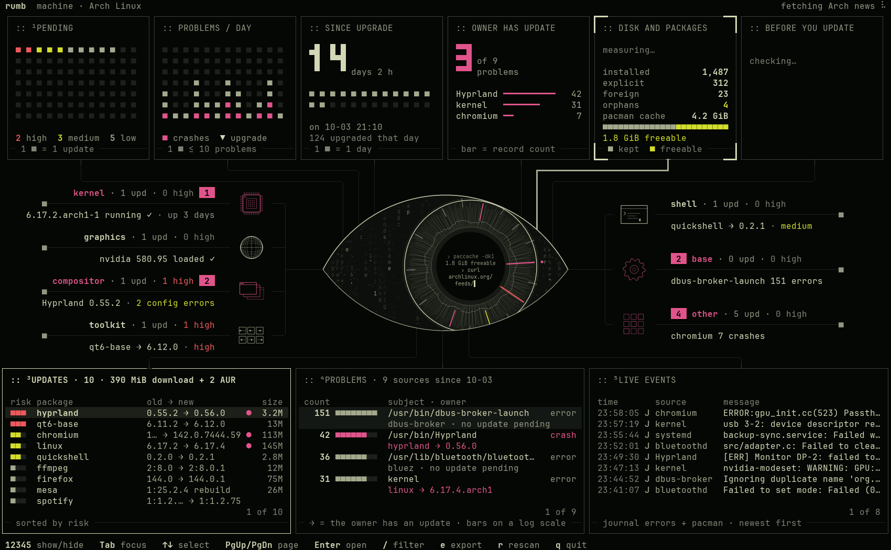

<h1 align="center">
  <picture>
    <source media="(prefers-color-scheme: dark)" srcset="docs/logo-dark.png">
    
  </picture>
</h1>

<p align="center">Track software health. Spot trouble early.</p>

<p align="center">A terminal dashboard for Arch Linux and Omarchy: what the next update brings, and what is already failing. It only reads and never asks for root.</p>

<p align="center">
  
</p>

## Omarchy

```sh
omarchy pkg add rumb     # install
omarchy update           # update, with the rest of the system
omarchy pkg drop rumb    # uninstall
```

## Arch Linux, from source

```sh
sudo pacman -S --needed git make cargo jq pacman-contrib fakeroot
git clone https://github.com/HANCORE-linux/rumb && cd rumb
make && sudo make install                  # install
git pull && make && sudo make install      # update
sudo make uninstall                        # uninstall
```

Run `rumb`. The manual is `man rumb`.

## Contributing

- [CONTRIBUTING.md](CONTRIBUTING.md) explains how to build rumb, run the checks and open a pull request.
- Design changes are not accepted, only proposals: open an issue with before/after screenshots.

[MIT](LICENSE)
