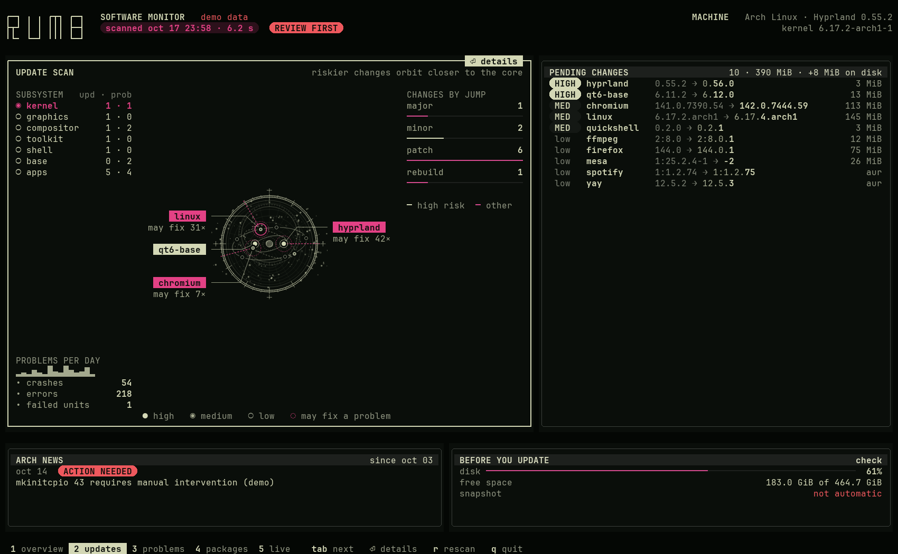
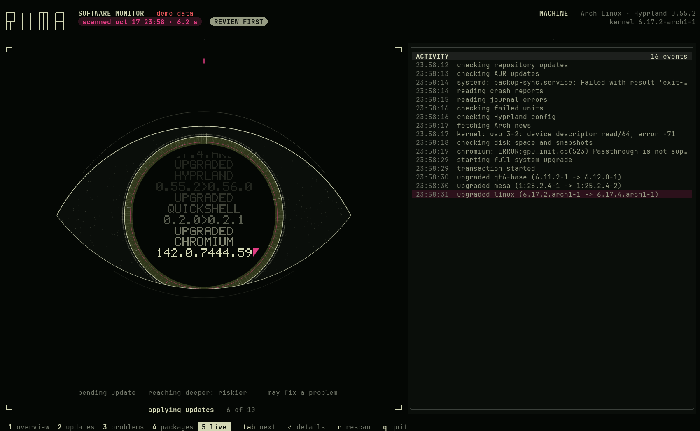

# rumb

Track software health. Spot trouble early.

A terminal dashboard for Arch Linux and Omarchy: what the next update brings, and what is already failing. It only reads and never asks for root.

<details>
<summary>
<a name="overview"></a>
<a name="updates"></a>
<a name="live"></a>
</summary>

<a name="overview-large"></a>
<a name="updates-large"></a>
<a name="live-large"></a>
</details>

## Omarchy

```sh
omarchy pkg add rumb     # install
omarchy update           # update, with the rest of the system
omarchy pkg drop rumb    # uninstall
```

## Arch Linux, from source

```sh
sudo pacman -S --needed git make cargo jq pacman-contrib fakeroot
git clone https://github.com/HANCORE-linux/rumb && cd rumb
make && sudo make install                  # install
git pull && make && sudo make install      # update
sudo make uninstall                        # uninstall
```

Run `rumb`. The manual is `man rumb`.

[MIT](LICENSE)
